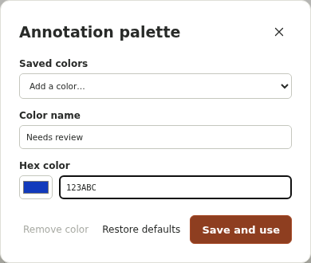
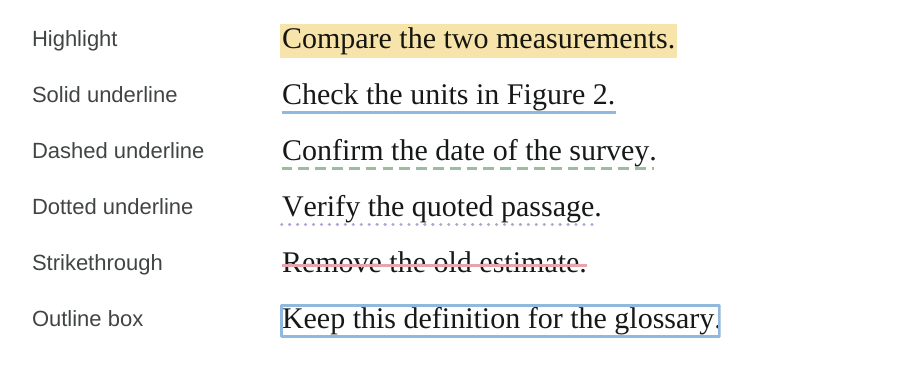
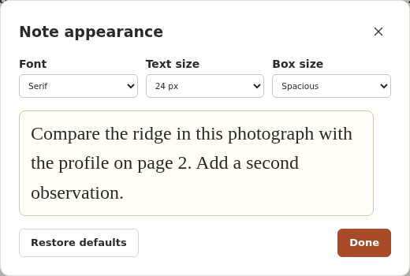

# Margin – PDF Annotator

Mark a passage, draw on a scan, or leave a note on a PDF. Margin works in **desktop Chrome or Chromium 141 or later**. Share a marked-up PDF, or move just your annotations to another copy of the same document.

## Install Margin

1. **[Download Margin for Chrome and Chromium (.zip)](https://github.com/vollero/pdf-annotator/releases/latest/download/margin-pdf-annotator.zip).** This ZIP contains the ready-to-use extension.
2. **Extract the ZIP.** On Windows, right-click it and choose **Extract All**. On macOS, double-click it. On Linux, use your archive manager’s **Extract** command. Move the extracted **Margin** folder somewhere you’ll keep it, such as your Documents folder. Open it once to check that it contains `manifest.json`.
3. **Load the extension.** Type `chrome://extensions` into the address bar and press Enter. Turn on **Developer mode** at the top right, click **Load unpacked**, and select the **Margin** folder that contains `manifest.json`. A **Margin – PDF Annotator** card should appear.
4. **Launch Margin.** Open a new tab, click the **Extensions** puzzle-piece button next to the address bar, then click **Margin – PDF Annotator**. Use the pin beside its name if you’d like a toolbar shortcut.

For pictures of the **Load unpacked** button and pin menu, see [Chrome’s illustrated instructions](https://developer.chrome.com/docs/extensions/get-started/tutorial/hello-world#load-unpacked)

## Try it on the sample

On your first launch from a new tab, Margin opens *Reading the Alps*. It already contains a few example marks.

1. Click **Highlight**, choose a color, and drag across a sentence. The passage appears under **Annotations** on the right.
2. Click **Note**, click a spot on the page, type a comment, and click **Save note**. To edit it later, click **Select**, then the note marker.
3. Click **Export PDF**. Your browser downloads **Reading the Alps-annotated.pdf**. Open that file in your PDF reader to see the marks, or reopen it in Margin to keep editing.


## Open your own PDF

- **From your computer.** Click **Open PDF** in the editor or drag a PDF onto the page.
- **From a website.** While viewing a PDF whose address path ends in `.pdf`, click Margin in the browser toolbar or Extensions menu. It opens that document in a new editor tab. Margin requests the clicked address without cookies. If the site requires a login, redirects to a download, or uses its own viewer, download the PDF there and use **Open PDF**.
- **On a scanned page,** use **Region** to attach a note to an area, **Draw** for freehand marks, or choose **Highlight** and drag from a blank spot to mark a rectangular area.

Margin accepts PDFs up to **64 MiB** and **3,000 pages**. If a scanned page exceeds the image limit (32 megapixels), open a lower-resolution copy.

Click an entry in **Annotations** to jump to its mark. Open the entry’s **…** menu to edit it or delete it. **Undo** and **Redo** apply to the current editing session.

## Format a note with Markdown

[Download the 0.3.0-rc.14 candidate ZIP](https://github.com/vollero/pdf-annotator/releases/download/v0.3.0-rc.14/margin-pdf-annotator.zip) and follow the [installation](#install-margin) or [update instructions](#update-margin).

1. Open a point note, region note, or passage comment and select **Format as Markdown**. Each note starts in plain text.
2. Try the example below. Open **Preview formatting** to see your changes while you write. Bulleted and numbered lists, bold, italics, and inline code work in the preview and the saved note.

   ```markdown
   **Figure 2** needs a correction.
   - Change the unit to `mm`.
   - Check the *horizontal* axis.
   ```

3. Save the note. You can read the formatting in **Annotations**, a page margin, a pinned preview, or an expanded note box. Reopen the note to edit its Markdown source. Clear **Format as Markdown** to display the punctuation literally. Quoted PDF text always reads as it appears in the document.

**Export PDF** gives other PDF readers readable comment text and draws styled text in expanded note boxes. Reopening the PDF in Margin restores the editable Markdown. **Export annotations** carries the source and formatting choice to another copy of the same PDF in Margin **0.3.0-rc.14 or later**. HTML, links, and image syntax display as text.

## Read notes in the page margin

1. Add a note or open an existing one. For a passage comment, select text and choose **Comment**. In the editor, set **Margin placement** to **Left margin** or **Right margin**, then save.
2. Read the note beside its passage as you scroll. A comment that spans pages appears on each quoted page. Click a margin note to read its full text, edit it, or switch sides. Choose **No margin copy** to remove the margin copy. **Undo** reverses the change.
3. Use **Hide workspace** for more reading room. In a narrow window or at high zoom, scroll horizontally to reach the other side. Crowded notes stack in passage order. If a stack is taller than its page, scroll inside that margin.

**Export annotations** carries the chosen side to the same PDF in Margin 0.3.0-rc.13 or later. **Export PDF** keeps the note anchored on the original page. Other PDF readers can show the annotation there, and reopening the export in Margin restores the margin layout.

## Pin a note preview

1. Hover over a compact note marker or a region’s border in **Select** mode, then click **Pin preview**. You can also open a note’s **…** menu in **Annotations** and choose **Pin preview**. The menu works for expanded notes and passage comments, too.
2. The preview stays in the upper-right corner of the PDF viewer as you scroll, change pages, zoom, or hide the workspace. Its heading identifies the source page. Edits to the note and changes to its action checkbox appear in the preview.
3. Click **Unpin preview** or press **Esc** while reading to close it. With a keyboard, focus a note marker and press **P** to pin or unpin it. Pinning a different note replaces the current preview.

The pin lasts for the current PDF in this tab. Reloading, opening another PDF, or deleting the pinned note clears it.

## Attach a note to a region

1. Choose **Region** (or press **R**) and drag from one corner of a diagram, table, or scanned passage to the opposite corner. You can also click once to start with a small rectangle.
2. Write your note and choose **Save note**. Select **Track as action** if you want a checkbox for the task. The note appears under **Annotations** as a **Region note**.
3. Switch to **Select**. Click the outline to edit the note, drag an edge to move it, or drag its lower-right grip to resize it. The middle stays clear for reading and selecting text. With the outline focused, **Shift + an arrow key** resizes it. **Esc** cancels a drag and **Undo** reverses a saved change.

**Export PDF** includes the outline and its comment so someone can review them in a PDF reader. To send only the annotations, choose **Export annotations**. The recipient can import them with the same PDF in Margin **0.3.0-rc.10 or later**.

## Convert a point note or region note

1. In **Annotations**, find the note you want to change and open its **…** menu. Choose **Convert to region note** to outline the part of the page your comment describes.
2. An expanded point note becomes an outline the size of its text box. A compact marker starts with the same small rectangle you get by clicking **Region** once. The outline starts at the marker’s upper-left corner and shifts inward when it needs room at a page edge. In **Select** mode, drag the border to move it or the lower-right grip to resize it.
3. To collapse a region into a compact marker, open the same menu and choose **Convert to point note**. To recover the exact previous shape, size and position, click **Undo**.

The note keeps its text, color, page and action status. **Export PDF** shows the new shape. **Export annotations** keeps the same annotation ID, so importing the JSON onto the same PDF updates the existing note.

## Resize a note on the page

1. Choose **Select**. Find a marker you placed with **Note** and drag its striped lower-right corner down and to the right. Your note’s text appears inside the box as you drag.
2. Release when you can see the lines you need. The top-left corner stays in place. To make room near a page edge, drag the body of the note toward the middle first. Click the body to open the full text.
3. To return to a compact marker, drag the corner up and left until both sides reach their smallest size. Press **Esc** during a drag to cancel, or choose **Undo** after releasing.

With a keyboard, use **Tab** to focus a note and **Shift + an arrow key** to adjust its width or height. Zoom scales the box with its page. **Note appearance** controls its font and text size. **Export PDF** includes the visible box and its full note text. To move the editable box to another copy of the same PDF, use **Export annotations** and open the JSON with **Import annotations** in Margin 0.3.0-rc.9 or later.

## Move a note marker

1. Choose **Select** and find a marker you placed with **Note**. Drag it to a new spot on the same page and release. A click opens the note for editing.
2. Press **Esc** during the drag to cancel. After releasing, use **Undo** to return the marker to its previous spot or **Redo** to move it again.

The note keeps its text, color, and action checkbox. Its new position follows the page when you zoom and travels with **Export PDF** and **Export annotations**. Passage comments stay anchored to their quoted words.

## Change the color of an existing annotation

1. In **Annotations**, find the highlight, drawing, note, or passage comment you want to recolor. Open its **…** menu and choose **Change color**.
2. Pick one of your **Saved colors**, click the color well, or type a six-digit **Hex color** such as `#176B87`. Click **Apply color**. For a comment spanning several pages, this updates the entire marked passage.
3. Click **Undo** to restore the previous color. **Export PDF** and **Export annotations** both include the applied color.

The toolbar color still controls your next annotation. You can use a one-off color on a card without adding a swatch to your palette.

## Customize your color palette

1. Click **Edit palette**, the palette icon next to the colored circles in the annotation toolbar.
2. Under **Saved colors**, choose **Add a color…**. Give it a name such as *Needs review*. Click the color well to use the browser’s picker, or enter a six-digit **Hex color** such as `#176B87`.
3. Click **Save and use**. The color moves to the first toolbar position and becomes active for your next highlight, underline, drawing, note, or passage comment. Click another swatch to switch. The toolbar shows five colors at a time. To use another saved color, pick it under **Saved colors** and click **Save and use**.

To edit or remove a color, choose it under **Saved colors**. Change its name or value and click **Save and use**, or click **Remove color**. **Restore defaults** brings back the original five swatches. Existing marks keep their individual colors when you edit the palette.

Margin remembers your palette in this browser profile. Recipients see the colors you used even if they have a different palette. In an Incognito tab, palette changes last until you reload or close that tab.



## Mark text with different styles

1. Open the arrow beside **Highlight**. Choose **Solid underline**, **Dashed underline**, **Dotted underline**, **Strikethrough**, or **Outline box**. Choose a color and drag over the words. The tool keeps that style for your next mark. Choose **Highlight** in the same menu to return to a filled highlight.
2. If you’ve already selected words with **Select**, use the arrow in the selection toolbar at the bottom of the PDF. Click the button showing the style’s name to mark the words, or click **Comment** to attach a note in that style.
3. To restyle an existing mark, find its card in **Annotations**, open **…**, and change **Markup style**. **Undo** reverses the change. A passage comment keeps its quotation, note, and checkbox.

**Export PDF** keeps the marks visible in other PDF readers. **Export annotations** carries the editable style to another copy of the exact same PDF.



## Comment on a passage

1. Choose **Select** and select the words you want to discuss. Choose **Comment** at the bottom of the PDF, or press **C** while the text is selected. The same toolbar lets you mark or copy the selection.
2. Read the quotation above the editor, write your comment, and click **Save comment**. Select **Track as action** if you want a checkbox. For a passage that crosses a page break, use **Continuous scrolling** and select across both pages.
3. The **Annotations** panel shows a quotation preview and your comment on one card. Click the card to return to the passage. To read the full quote or edit your comment, click the note marker beside the passage or choose **… → Edit comment**. Search matches both the full quote and your words.

**Export PDF** places your comment and its text markup on each selected page. Reopening it in Margin restores one editable comment. **Export annotations** also keeps the quotation, page positions, comment, and action status together. For a scanned page without selectable text, use **Region** to outline an area or **Note** to comment at a point.

## Search annotations

In the **Annotations** panel, type in **Search annotations** to find words in notes and highlighted passages. Results update as you type. Click a result, or focus it and press **Enter**, to jump to its mark.

- To find an unfinished correction, choose **To do** and type `Figure 2`. Both words must occur in the annotation. Capitalization and word order can vary.
- To see annotations on a particular page, type `page 12`. Add words, such as `page 12 units`, to narrow the results. Typing just `12` also finds annotations that mention 12 elsewhere.
- Press **Escape** in the search box to clear it. Your page and action filters stay selected. Exports include every mark in the document.

## Track actions with note checkboxes

1. Add a note, or choose **… → Edit note** on an existing one. Describe the action, for example “Correct the units in Figure 2.” Select **Track as action**, then **Save note**.
2. In **Annotations**, tick the note’s **To do** checkbox when you finish. The label changes to **Done**. Untick it to reopen the action. You can also change **Done** inside the note editor.
3. Use the **All annotations** menu to see only **To do** or **Done** actions. The counts follow the search and the **All pages** or **Current page** selection. Choose **All annotations** to see ordinary notes, drawings and highlights again.

**Undo** reverses a checkbox change. To keep the comment and remove its checkbox, edit the note and clear **Track as action**. Status is saved with the document. **Export annotations** carries it to another Margin installation, and **Export PDF** includes it in the comment text for readers outside Margin.

## Make notes easier to read

These controls are included in the [0.3.0 release candidate](https://github.com/vollero/pdf-annotator/releases/download/v0.3.0-rc.14/margin-pdf-annotator.zip).

1. Choose **Note appearance** at the top of the **Annotations** panel or inside an open note. You can adjust the settings while writing a draft.
2. Choose a **Font** (sans serif, serif or monospace), **Text size** (14–32 px) and **Box size** (Compact, Comfortable or Spacious). The preview shows how your text will look. Box size changes the panel width, the writing area and the space available for long comments.
3. Choose **Done** to return to your note. In **Select** mode, hover over a note marker to read it on the PDF, or focus it with **Tab** and press **Enter** to edit. Press **Escape** to dismiss the preview.

Margin starts with 18 px sans serif text and a Comfortable box. It remembers your reading preferences in this browser profile and applies them to existing notes and new ones. Exported annotations carry their text and placement, so each person can choose their own appearance. **Restore defaults** returns all three settings to their starting values.



## Move annotations to another copy of the same PDF

1. Open the PDF you annotated. In the **Annotations** panel, click **Export annotations**. Margin downloads a file such as `Field notes.margin-annotations.json` with your highlights, drawings, notes, and the PDF’s SHA-256 fingerprint. All pages are included, even when the list is filtered. If the panel is hidden, click **Show workspace** or **Toggle annotations** to bring it back.
2. On the other computer, or in a later session, open the **exact same PDF**. For Markdown notes, install **0.3.0-rc.14 or later**. Margin placement requires at least **0.3.0-rc.13**. The file format guide below lists compatible releases for earlier exports. Send the original PDF separately if the recipient needs it. A renamed copy works. Re-saving the PDF or using **Export PDF** produces a different file when its bytes change.
3. Click **Import annotations** and select the JSON file. Margin checks the fingerprint before applying changes. It adds new marks, updates matching marks, and keeps other local annotations. Importing an identical file twice adds no duplicates. **Undo** reverses the import in one step.

If Margin reports a fingerprint mismatch, locate the copy that was open when you exported the annotations. A matching filename or page count is insufficient. The JSON contains readable note text and selected highlight text. [Annotation file format and worked example](docs/annotation-migration.md)

## Reading controls

The controls at the bottom of the editor change how you read the PDF.

- Choose **Continuous scrolling** in the **Single page** menu to scroll from one page straight into the next. The page counter follows your reading position. Choose **Single page** to switch back.
- Click **Hide workspace** to give the PDF more room. The page, zoom, and scrolling controls stay at the bottom. Click **Show workspace** or press **Esc** to bring the editor back.
- Click **+** or **−** to zoom the PDF. The percentage shows its current scale. The **Fit to width** button resizes the page to the available space. You can also press **+**, **−**, or **0** for the same actions.

Margin remembers your scrolling mode and workspace visibility the next time you open it.

## Where your edits go

**Saved locally** means your draft is stored in this browser profile. Reopen Margin to return to the last document, or open the same PDF again to recover its draft. Local PDFs can be edited offline. In an Incognito window, Margin keeps the document in memory. Export it before closing the tab.

**Export PDF** creates a separate file with your highlights, drawings, and notes. Use it to send someone a copy, move to another computer, or keep your work before removing the extension or clearing browser data. Your original PDF stays intact. To share a copy with a Margin note removed, delete the note and export again with the current release. Other PDF content, attachments, and metadata can travel with the export. Use a redaction tool for sensitive information in the underlying document.

## Update Margin

If you removed or replaced a note in a PDF exported with an earlier version, open that file in the updated extension and export a fresh copy before sharing it. [Security review](docs/security-review.md)

Export any work you want to back up, close Margin, and extract the new ZIP. Replace the contents of the **same Margin folder** you loaded originally. At `chrome://extensions`, click the circular **Reload** arrow on the Margin card, then reopen the editor.

The install button above downloads the latest stable version. To try a candidate, choose a version marked **Pre-release** and download **margin-pdf-annotator.zip** under **Assets**. [Browse releases](https://github.com/vollero/pdf-annotator/releases)

## Troubleshooting

- **“Manifest file is missing or unreadable.”** Extract the download first. If there are nested folders, select the one where you can see both `manifest.json` and `vendor`. The install link above downloads the packaged extension.
- **The toolbar can’t read a local PDF tab.** Use **Open PDF**, or go to `chrome://extensions` → **Margin** → **Details** and turn on **Allow access to file URLs** to open PDFs directly from local tabs.
- **A PDF asks for a password.** Open an unlocked copy in Margin.

<details>
<summary>Build and test from source (developers)</summary>

With Node.js 24 installed, run these commands in a clone of this repository.

```sh
npm ci
npm run build
```

Load the generated `dist` folder with **Load unpacked**. After a source change, rebuild and click **Reload** on the extension card. Run the unit and Chromium integration tests with the following commands.

```sh
npm test
npx playwright-core install chromium
npm run test:browser
```

Set `CHROMIUM_PATH` to use an installed Chromium binary for the browser test. The source lives in `extension/`. The build bundles PDF.js, pdf-lib, the Marked Markdown parser, fonts, character maps, and image decoders. Margin uses `activeTab` for the tab you click and session-only extension storage to pass its address to the new editor tab.

</details>

<details>
<summary>Sample document artwork</summary>

The sample PDF can be regenerated with `node scripts/sample/create.mjs`. Its embedded landscape illustration is stored in [scripts/sample/alpine-ridge.jpg](scripts/sample/alpine-ridge.jpg). The built-in image generator used this prompt.

> A panoramic analog editorial landscape photograph for an alpine field journal. A sharp, sculptural Dolomite limestone ridgeline, layer after layer of muted blue-grey and warm stone peaks, a dark forested slope low in the foreground. Pale cloudy sky, soft overcast morning light, fine film grain. Frame wide, with the jagged skyline in the middle third. Naturalistic, no people, buildings, lettering, borders or graphics.

</details>

## License

Margin’s original code, documentation, icons, and sample materials are available under the **Apache License 2.0**, to the extent of the contributors’ rights. You can use them in commercial and closed-source projects. When redistributing Margin, include the license, retain applicable notices, and mark files you changed. Contributors grant a patent license for claims covered by section 3. Your own PDFs keep their existing licenses. [Project license](LICENSE)

The extension ZIP includes the project license and the notices for its bundled PDF libraries, fonts, character maps, and image decoders. [Third-party notices](THIRD_PARTY_NOTICES.md)
