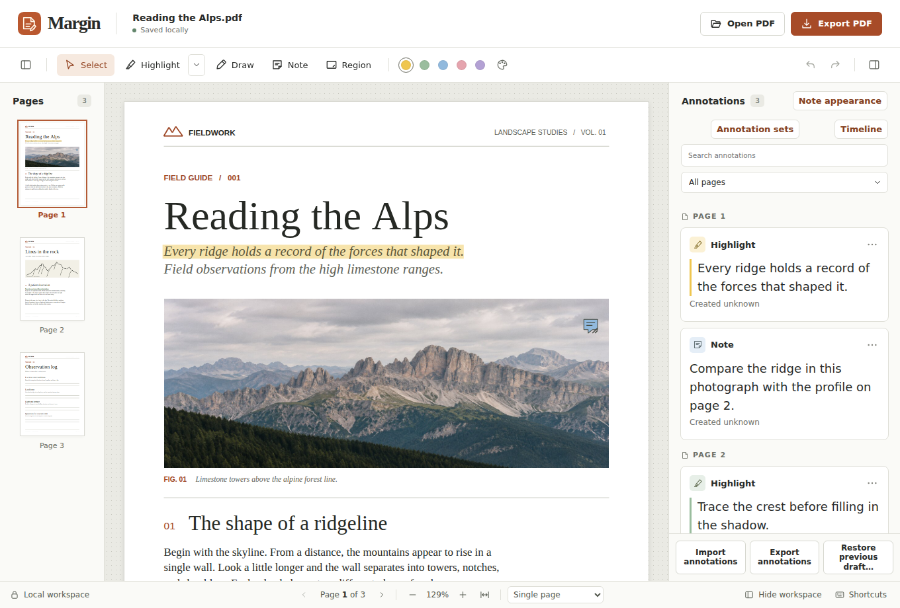

# Margin – PDF Annotator

Highlight text, draw on a scan, or leave a note on a PDF. Margin works in **desktop Chrome or Chromium 141 or later**. Share a marked-up PDF, or move just your annotations to another copy of the same document.

## Install Margin

1. **[Download Margin for Chrome and Chromium (.zip)](https://github.com/vollero/pdf-annotator/releases/latest/download/margin-pdf-annotator.zip).** This ZIP contains the ready-to-use extension.
2. **Extract the ZIP.** On Windows, right-click it and choose **Extract All**. On macOS, double-click it. On Linux, use your archive manager’s **Extract** command. Move the extracted **Margin** folder somewhere you’ll keep it, such as your Documents folder. Open it once to check that it contains `manifest.json`.
3. **Load the extension.** Type `chrome://extensions` into the address bar and press Enter. Turn on **Developer mode** at the top right, click **Load unpacked**, and select the **Margin** folder that contains `manifest.json`. A **Margin – PDF Annotator** card should appear.
4. **Launch Margin.** Open a new tab, click the **Extensions** puzzle-piece button next to the address bar, then click **Margin – PDF Annotator**. Use the pin beside its name if you’d like a toolbar shortcut.

For pictures of the **Load unpacked** button and pin menu, see [Chrome’s illustrated instructions](https://developer.chrome.com/docs/extensions/get-started/tutorial/hello-world#load-unpacked)

## Try it on the sample

On your first launch from a new tab, Margin opens *Reading the Alps*. It already contains a few example marks.

1. Click **Highlight**, choose a color, and drag across a sentence. The passage appears under **Annotations** on the right.
2. Click **Note**, click a spot on the page, type a comment, and click **Save note**. To edit it later, click **Select**, then the note marker.
3. Click **Export PDF**. Your browser downloads **Reading the Alps-annotated.pdf**. Open that file in your PDF reader to see the marks, or reopen it in Margin to keep editing.



## Open your own PDF

- **From your computer.** Click **Open PDF** in the editor or drag a PDF onto the page.
- **From a website.** While viewing a PDF whose address path ends in `.pdf`, click Margin in the browser toolbar or Extensions menu. It opens that document in a new editor tab. Margin requests the clicked address without cookies. If the site requires a login, redirects to a download, or uses its own viewer, download the PDF there and use **Open PDF**.
- **On a scanned page,** use **Draw** for freehand marks, or choose **Highlight** and drag from a blank spot to mark a rectangular area.

Margin accepts PDFs up to **64 MiB** and **3,000 pages**. If a scanned page exceeds the image limit (32 megapixels), open a lower-resolution copy.

Click an entry in **Annotations** to jump to its mark. Open the entry’s **…** menu to delete it. **Undo** and **Redo** apply to the current editing session.

## Track actions with note checkboxes

To try checkboxes and adjustable note text, [download the 0.3.0-rc.2 candidate ZIP](https://github.com/vollero/pdf-annotator/releases/download/v0.3.0-rc.2/margin-pdf-annotator.zip) and follow the [installation](#install-margin) or [update instructions](#update-margin).

1. Add a note, or choose **… → Edit note** on an existing one. Describe the action, for example “Correct the units in Figure 2.” Select **Track as action**, then **Save note**.
2. In **Annotations**, tick the note’s **To do** checkbox when you finish. The label changes to **Done**. Untick it to reopen the action. You can also change **Done** inside the note editor.
3. Use the **All annotations** menu to see only **To do** or **Done** actions. The counts follow the **All pages** or **Current page** selection. Choose **All annotations** to see ordinary notes, drawings and highlights again.

**Undo** reverses a checkbox change. To keep the comment and remove its checkbox, edit the note and clear **Track as action**. Status is saved with the document. **Export annotations** carries it to another Margin installation, and **Export PDF** includes it in the comment text for readers outside Margin.

## Make notes easier to read

These controls are included in the [0.3.0 release candidate](https://github.com/vollero/pdf-annotator/releases/download/v0.3.0-rc.2/margin-pdf-annotator.zip).

1. Choose **Note appearance** at the top of the **Annotations** panel or inside an open note. You can adjust the settings while writing a draft.
2. Choose a **Font** (sans serif, serif or monospace), **Text size** (14–32 px) and **Box size** (Compact, Comfortable or Spacious). The preview shows how your text will look. Box size changes the panel width, the writing area and the space available for long comments.
3. Choose **Done** to return to your note. In **Select** mode, hover over a note marker to read it on the PDF, or focus it with **Tab** and press **Enter** to edit. Press **Escape** to dismiss the preview.

Margin starts with 18 px sans serif text and a Comfortable box. It remembers your reading preferences in this browser profile and applies them to existing notes and new ones. Exported annotations carry their text and placement, so each person can choose their own appearance. **Restore defaults** returns all three settings to their starting values.


## Move annotations to another copy of the same PDF

1. Open the PDF you annotated. In the **Annotations** panel, click **Export annotations**. Margin downloads a file such as `Field notes.margin-annotations.json` with your highlights, drawings, notes, and the PDF’s SHA-256 fingerprint. All pages are included, even when the list is filtered. If the panel is hidden, click **Show workspace** or **Toggle annotations** to bring it back.
2. On the other computer, or in a later session, open the **exact same PDF**. Use Margin **0.3.0-rc.2 or later** for files containing action checkboxes. Other annotation files work with **0.2.0 or later**. Send the original PDF separately if the recipient needs it. A renamed copy works. Re-saving the PDF or using **Export PDF** produces a different file when its bytes change.
3. Click **Import annotations** and select the JSON file. Margin checks the fingerprint before applying changes. It adds new marks, updates matching marks, and keeps other local annotations. Importing an identical file twice adds no duplicates. **Undo** reverses the import in one step.

If Margin reports a fingerprint mismatch, locate the copy that was open when you exported the annotations. A matching filename or page count is insufficient. The JSON contains readable note text and selected highlight text. [Annotation file format and worked example](docs/annotation-migration.md)

## Reading controls

The controls at the bottom of the editor change how you read the PDF.

- Choose **Continuous scrolling** in the **Single page** menu to scroll from one page straight into the next. The page counter follows your reading position. Choose **Single page** to switch back.
- Click **Hide workspace** to give the PDF more room. The page, zoom, and scrolling controls stay at the bottom. Click **Show workspace** or press **Esc** to bring the editor back.
- Click **+** or **−** to zoom the PDF. The percentage shows its current scale. The **Fit to width** button resizes the page to the available space. You can also press **+**, **−**, or **0** for the same actions.

Margin remembers your scrolling mode and workspace visibility the next time you open it.

## Where your edits go

**Saved locally** means your draft is stored in this browser profile. Reopen Margin to return to the last document, or open the same PDF again to recover its draft. Local PDFs can be edited offline. In an Incognito window, Margin keeps the document in memory. Export it before closing the tab.

**Export PDF** creates a separate file with your highlights, drawings, and notes. Use it to send someone a copy, move to another computer, or keep your work before removing the extension or clearing browser data. Your original PDF stays intact. To share a copy with a Margin note removed, delete the note and export again with the current release. Other PDF content, attachments, and metadata can travel with the export. Use a redaction tool for sensitive information in the underlying document.

## Update Margin

If you removed or replaced a note in a PDF exported with an earlier version, open that file in the updated extension and export a fresh copy before sharing it. [Security review](docs/security-review.md)

Export any work you want to back up, close Margin, and extract the new ZIP. Replace the contents of the **same Margin folder** you loaded originally. At `chrome://extensions`, click the circular **Reload** arrow on the Margin card, then reopen the editor.

The install button above downloads the latest stable version. To try a candidate, choose a version marked **Pre-release** and download **margin-pdf-annotator.zip** under **Assets**. [Browse releases](https://github.com/vollero/pdf-annotator/releases)

## Troubleshooting

- **“Manifest file is missing or unreadable.”** Extract the download first. If there are nested folders, select the one where you can see both `manifest.json` and `vendor`. The install link above downloads the packaged extension.
- **The toolbar can’t read a local PDF tab.** Use **Open PDF**, or go to `chrome://extensions` → **Margin** → **Details** and turn on **Allow access to file URLs** to open PDFs directly from local tabs.
- **A PDF asks for a password.** Open an unlocked copy in Margin.

<details>
<summary>Build and test from source (developers)</summary>

With Node.js 24 installed, run these commands in a clone of this repository.

```sh
npm ci
npm run build
```

Load the generated `dist` folder with **Load unpacked**. After a source change, rebuild and click **Reload** on the extension card. Run the unit and Chromium integration tests with the following commands.

```sh
npm test
npx playwright-core install chromium
npm run test:browser
```

Set `CHROMIUM_PATH` to use an installed Chromium binary for the browser test. The source lives in `extension/`. The build bundles PDF.js, pdf-lib, fonts, character maps, and image decoders. Margin uses `activeTab` for the tab you click and session-only extension storage to pass its address to the new editor tab.

</details>

<details>
<summary>Sample document artwork</summary>

The sample PDF can be regenerated with `node scripts/sample/create.mjs`. Its embedded landscape illustration is stored in [scripts/sample/alpine-ridge.jpg](scripts/sample/alpine-ridge.jpg). The built-in image generator used this prompt.

> A panoramic analog editorial landscape photograph for an alpine field journal. A sharp, sculptural Dolomite limestone ridgeline, layer after layer of muted blue-grey and warm stone peaks, a dark forested slope low in the foreground. Pale cloudy sky, soft overcast morning light, fine film grain. Frame wide, with the jagged skyline in the middle third. Naturalistic, no people, buildings, lettering, borders or graphics.

</details>

## License

Margin’s original code, documentation, icons, and sample materials are available under the **Apache License 2.0**, to the extent of the contributors’ rights. You can use them in commercial and closed-source projects. When redistributing Margin, include the license, retain applicable notices, and mark files you changed. Contributors grant a patent license for claims covered by section 3. Your own PDFs keep their existing licenses. [Project license](LICENSE)

The extension ZIP includes the project license and the notices for its bundled PDF libraries, fonts, character maps, and image decoders. [Third-party notices](THIRD_PARTY_NOTICES.md)
